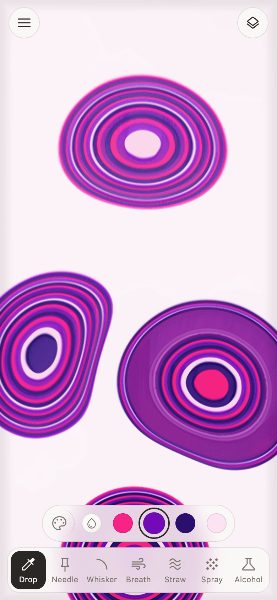
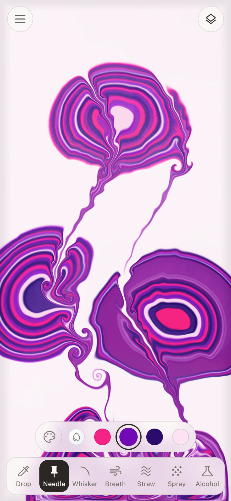

# Suminagashi

Floating ink on water, in the browser.

[Suminagashi](https://en.wikipedia.org/wiki/Suminagashi) (墨流し, "floating ink") is the
Japanese art of paper marbling: drops of ink and drops of soapy water go onto still water
in turn, spread into thin concentric rings, and are moved with a breath, a fan or a fine
needle. Then a sheet of paper is laid onto the water and takes up the picture.

This app is a real-time simulation of that process. It runs on phones and desktops and
you can install it as an app (PWA).

**Try it: [suminagashi.gnass.buzz](https://suminagashi.gnass.buzz)**

<p align="center">
  
  &nbsp;&nbsp;
  
</p>

## Features

- **Drop**: touch the water and a drop of the selected ink spreads. Hold for a bigger drop.
  The soap swatch (left of the inks) drops clear water. Select soap, then an ink, and the
  drops alternate between ink and soap, which makes rings. With a mouse, the right button
  drops soap.
- **Needle**: pulls the ink along and curls it.
- **Whisker**: combs fine lines without swirls.
- **Breath** and **Straw**: touch where the air comes from, then drag to aim.
- **Spray**: flicks fine drops, as from a toothbrush.
- **Alcohol**: a tap tears the ink film open. Hold to push the ink away.
- **Print**: lays paper on the water. You get the picture as the paper takes it up
  (mirrored), to save or share. A faint ghost stays on the water.
- **Palettes**: a set of ink palettes, each with a matching paper colour.
- **Demo**: the app shows how it is used. It selects the tools and inks in the tool bar,
  says in a hint what it does, and works the water with a visible finger. Touch the water
  or the tool bar to take over. Behind the start panel, an artist works at the bath on her own.

### Keyboard shortcuts

| Key | Action        |
| --- | ------------- |
| 1–7 | Select a tool |
| C   | Next ink      |
| X   | Soap          |
| P   | Print         |
| N   | New bath      |
| Esc | Close a panel |

## How it works

The simulation runs on the GPU with WebGL 2 and uses two complementary models:

1. **Drops** are an exact, area-preserving radial deformation of the ink film (the drop
   map of "mathematical marbling"). Each new drop pushes all ink that is already on the
   water outward, so the rings get thinner with every drop and the edges stay sharp.
2. **Everything else that moves the water** (breath, straw, needle) drives a 2D
   incompressible fluid solver (stable fluids with vorticity confinement). The fluid
   advects the ink film with clamped Catmull-Rom sampling, so lines stay crisp.

The whisker is a "tine" deformation: it combs thin lines and does not make vortices.

Inks mix by absorbance (Beer–Lambert law): each ink stores what it takes out of the light
per channel, so overlapping films get darker, as real ink does.

### Source overview

| File                 | Contents                                                                             |
| -------------------- | ------------------------------------------------------------------------------------ |
| `src/bath.ts`        | The water: drop deformation and fluid solver                                         |
| `src/main.ts`        | UI and gestures                                                                      |
| `src/artist.ts`      | The demo artist                                                                      |
| `src/palettes.ts`    | Ink palettes                                                                         |
| `src/vendor/colors/` | Palette model from [colors](https://github.com/fgnass/colors), for the paper colours |

## Development

Requires a current Node.js (CI uses version 24).

```sh
npm install
npm run dev       # dev server on http://localhost:5173
npm run build     # static site in dist/
npm run preview   # serve the build
npm run icons     # app icons from icons/icon.png and icons/maskable.png
```

### URL parameters

| Parameter   | Effect                                                                   |
| ----------- | ------------------------------------------------------------------------ |
| `?ink=1600` | Long side of the ink film in pixels (default: 1600)                      |
| `?fps=60`   | Fixed frame rate (default: full rate while you touch the water, else 30) |

## License

[MIT](LICENSE) © Felix Gnass
